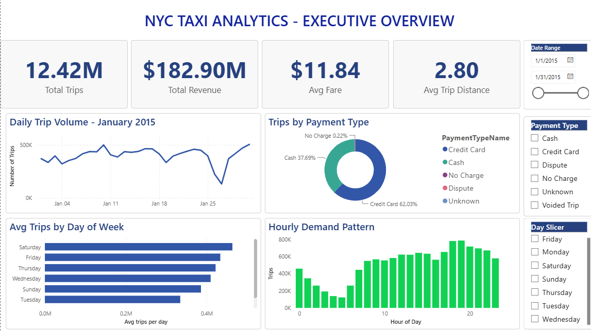
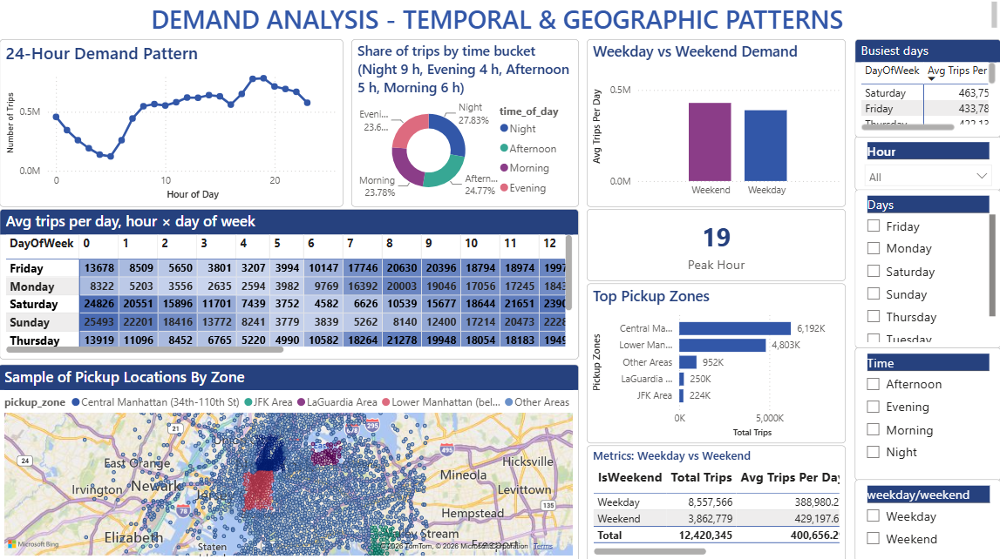
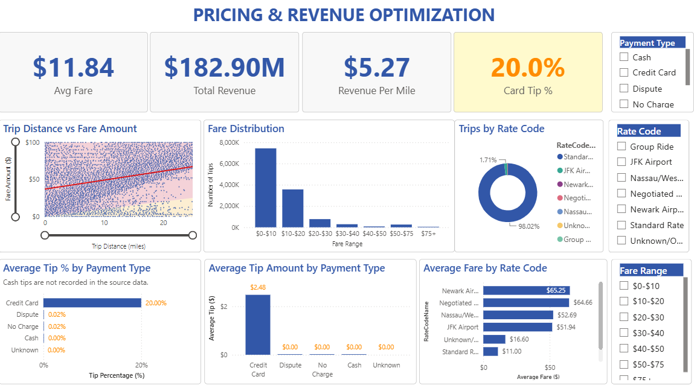

# NYC Taxi Analytics: Demand, Pricing & Tipping (Power BI)
 
An interactive four-page Power BI report on **12.4M NYC yellow-taxi trips from January 2015**. It shows when and where demand is highest, how fares vary by rate code and zone, and how card riders tip.
 
Built end to end: Power Query cleaning of a 1.84 GB CSV, a star-schema data model, 24 DAX measures and three dashboards plus a data notes page.
 




A PDF export of all pages is in the [`dashboards/`](dashboards/) folder.
 
## Dataset
 
- **Source:** [NYC Taxi & Limousine Commission (TLC) yellow taxi trip records, January 2015 (Kaggle)](https://www.kaggle.com/datasets/elemento/nyc-yellow-taxi-trip-data?select=yellow_tripdata_2015-01.csv). The CSV is not included in this repo because of its size.
- **Size:** 12,748,986 raw rows, 12,420,345 after cleaning (328,641 removed, 2.58%).
- **Columns:** 19 (pickup/dropoff time and coordinates, distance, passengers, rate code, payment type, fare, extras, taxes, tip, tolls, total).
## Business questions
 
1. **When** is demand highest, and how do weekdays differ from weekends?
2. **Where** do trips start, and which areas matter most for fleet deployment?
3. **How** do fares, rate codes and tips differ, and what drives revenue?
## Key findings
 
**Demand**
- Demand peaks between 6 and 7 PM on every day of the week, and the single busiest hour is Friday at 7 PM.
- Weekend days average about 10% more trips than weekdays (429K vs 389K per day). Saturday is the busiest day at about 464K trips per day.
- Late nights stay busy on weekends: midnight averages about 25K trips an hour on both Saturday and Sunday mornings, similar to a weekday morning rush.
- Trips fell to about a third of a normal day around the Jan 26-27 snowstorm.

**Geography**
- 88.5% of pickups are in Manhattan below 110th St: Central Manhattan (about 34th-110th St) 49.9%, Lower Manhattan (below about 34th St) 38.7%.
- Airport areas are small in volume but large in revenue: JFK and LaGuardia pickups are 3.8% of trips and about 12% of base fares.

**Pricing**
- Average fare is $11.84, average distance 2.80 miles, revenue per mile $5.27, total revenue $182.9M.
- 89% of trips cost $20 or less.
- Non-standard rate codes (JFK, Newark, negotiated, Nassau/Westchester) are 2.0% of trips but 8.9% of base fares. JFK averages $51.94 per trip and Newark $65.25, against $11.00 for the standard rate.

**Tipping (card trips only)**
- Card riders tip **20.0% of the base fare** on average ($2.48), and the rate is similar in every zone (18.8% to 21.8%). Airports differ in dollars, not rate, because fares are larger.
- **Cash tips are not recorded in the TLC data**, so cash trips show 0% and tip analysis is limited to card trips.
## Dashboards

| Page | Purpose | Contents |
|---|---|---|
| Executive Overview | Headline KPIs | Total trips, revenue, average fare and distance; daily trend; payment mix; average trips per weekday; hourly demand; date, payment and day slicers |
| Demand Analysis | When and where | Hour x day heat map (average trips per day), 24-hour pattern, time-of-day mix, weekday vs weekend, top pickup zones, pickup map sample |
| Pricing & Revenue | Fares and tips | Fare vs distance, fare distribution, trips and average fare by rate code, card tip rate and average tip, slicers |
| About this report | Data notes and methodology | Data source and cleaning rules, zone definitions, tip definition (card trips only, cash tips unrecorded), per-day average method, and known limitations |
 
## Data model
 
A star schema: one fact table and four dimensions.
 
- **Fact:** `Trips`
- **Dimensions:** `DateTable`, `TimeTable`, `RateCodeDim`, `PaymentTypeDim` (each one-to-many to `Trips`)
- **Measures table:** `_Measures` (24 measures)

Weekday/weekend flags and day names come from `DateTable` only.
 
## Data cleaning (Power Query)
 
Applied in this order:
 
1. Pickup datetime is not empty
2. Dropoff datetime is not empty
3. `fare_amount > 0`
4. `trip_distance > 0`
5. `trip_distance <= 100`
6. `passenger_count` between 1 and 6
7. Pickup longitude between -74.3 and -73.7
8. Pickup latitude between 40.5 and 40.9
9. Dropoff longitude between -74.3 and -73.7
10. `tip_amount <= 1000` (removes one corrupt record with a $3,950,588.80 tip)

Fares are not capped: the largest is $900 and only 54 trips exceed $200. Dropoff latitude is not filtered.
 
Columns added in Power Query: `trip_duration_minutes`, `pickup_hour`, `pickup_date`, `time_of_day` (Morning 6-12, Afternoon 12-17, Evening 17-21, Night 21-6).
 
## DAX
 
### Calculated columns
 
```DAX
pickup_zone =
SWITCH(
    TRUE(),
    Trips[pickup_latitude] >= 40.75 && Trips[pickup_latitude] <= 40.80 &&
    Trips[pickup_longitude] >= -74.00 && Trips[pickup_longitude] <= -73.95,
        "Central Manhattan (34th-110th St)",
 
    Trips[pickup_latitude] >= 40.70 && Trips[pickup_latitude] < 40.75 &&
    Trips[pickup_longitude] >= -74.02 && Trips[pickup_longitude] <= -73.97,
        "Lower Manhattan (below 34th St)",
 
    Trips[pickup_latitude] >= 40.63 && Trips[pickup_latitude] <= 40.68 &&
    Trips[pickup_longitude] >= -73.80 && Trips[pickup_longitude] <= -73.75,
        "JFK Area",
 
    Trips[pickup_latitude] >= 40.76 && Trips[pickup_latitude] <= 40.79 &&
    Trips[pickup_longitude] >= -73.90 && Trips[pickup_longitude] <= -73.85,
        "LaGuardia Area",
 
    "Other Areas"
)
```
 
`fare_bins` groups `fare_amount` into $0-10, $10-20, $20-30, $30-40, $40-50, $50-75 and $75+.
 
### Key measures
 
```DAX
Total Trips      = COUNTROWS(Trips)
Total Revenue    = SUM(Trips[total_amount])
Avg Fare         = AVERAGE(Trips[fare_amount])
Revenue Per Mile = DIVIDE([Total Revenue], [Total Distance], 0)
Avg Speed MPH    = DIVIDE([Total Distance], SUM(Trips[trip_duration_minutes]) / 60, 0)
Tip Percentage   = DIVIDE(SUM(Trips[tip_amount]), SUM(Trips[fare_amount]), 0)
Card Tip %       = CALCULATE([Tip Percentage], PaymentTypeDim[PaymentTypeName] = "Credit Card")
Avg Trips Per Day = DIVIDE([Total Trips], DISTINCTCOUNT(DateTable[Date]))
```
 
## Methodology notes
 
- **Per-day averages:** January 2015 has five Thursdays, Fridays and Saturdays and four of every other weekday, so raw totals by weekday are misleading. Day comparisons use average trips per day.
- **Tip %** is tip divided by base fare, on card trips only.
- **Zones** are approximate latitude/longitude bounding boxes, not official TLC taxi zones.
- **Time-of-day buckets** have unequal lengths (Night is 9 hours, Evening is 4), so their shares are not directly comparable.
## Limitations
 
- One month of data: no seasonality, and January 1 and the Jan 26-27 snowstorm distort some days.
- Cash tips are not recorded, so tipping findings describe card riders only.
- Zone boundaries are approximate; joining pickups to the official TLC taxi-zone polygons would be more accurate.
- No driver, vehicle or weather data, so the report describes patterns and does not explain causes.
## Interactive version

The Power BI file (.pbix) is too large to host here. To explore it, email me or message me on LinkedIn (see below) and I'll share it.

To refresh it against your own copy of the data: download `yellow_tripdata_2015-01.csv`, then in Power Query go to **Home -> Data source settings -> Change Source**, point to the CSV, and click **Close & Apply**. Loading 12M+ rows takes several minutes.

## Tools
 
Power BI Desktop, Power Query (M), DAX
 

## 📬 Get In Touch

Always happy to connect — whether it's feedback on this project, talking data, or exploring opportunities.

**Email:** [syedawaiswaseem@gmail.com](mailto:syedawaiswaseem@gmail.com)
**LinkedIn:** [linkedin.com/in/syed-awais-waseem](https://www.linkedin.com/in/syed-awais-waseem/)
